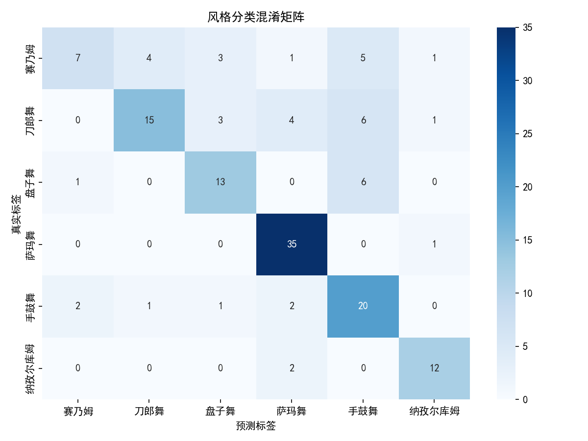
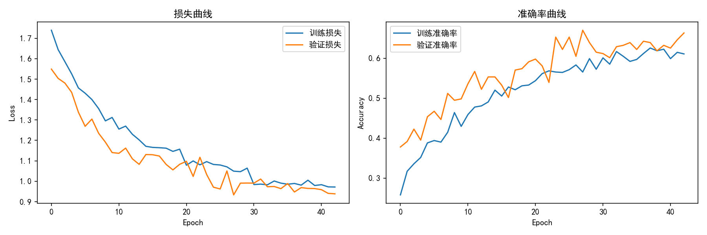
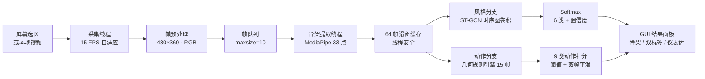

# 新疆舞多风格细粒度动作识别系统

> 基于 MediaPipe 骨架与 ST-GCN 的实时桌面识别软件：框选屏幕任意区域，即可同步输出舞蹈**风格**与**细粒度动作**两个标签。

<p>  
  
  
  
  
</p>

---

## 项目简介

新疆舞包含赛乃姆、刀郎舞、盘子舞、萨玛舞、手鼓舞、纳孜尔库姆等多个流派，各流派在体态、动律、手位上差异明显，但都以"扭颈、翻腕、摆肩、垫步、旋转"等**细粒度动作**为共同语汇。这带来一个典型的双层识别问题：**风格是流派的宏观归属，动作是瞬间的微观行为**，二者时间尺度不同，用单一分类器很难同时做好。

本项目以纯视觉、无标记（markerless）的方式解决这个问题：

- 从屏幕选区或本地视频取流，MediaPipe 提取 33 点人体骨架，不依赖任何穿戴设备；
- **风格识别**用 ST-GCN 在 64 帧（约 10 秒）长片段上做时序图卷积分类，捕捉整体律动；
- **动作识别**用几何规则引擎在 15 帧滑动窗口上对 9 类典型动作做打分，捕捉瞬时姿态变化；
- 全部封装进 PyQt6 桌面界面，多线程解耦采集、骨架提取与推理，实时显示骨架、双标签、置信度与性能曲线。

## 效果

风格分类在 146 个测试样本上达到 **69.9%** 准确率（6 类），混淆矩阵如下：



训练过程（验证准确率约收敛于 65%，无严重过拟合）：



各类别召回情况差异较大，其中萨玛舞最好、赛乃姆最弱：

| 风格     |    测试样本 |      正确 |       召回率 |
| ------ | ------: | ------: | --------: |
| 赛乃姆    |      21 |       7 |     33.3% |
| 刀郎舞    |      29 |      15 |     51.7% |
| 盘子舞    |      20 |      13 |     65.0% |
| 萨玛舞    |      36 |      35 |     97.2% |
| 手鼓舞    |      26 |      20 |     76.9% |
| 纳孜尔库姆  |      14 |      12 |     85.7% |
| **合计** | **146** | **102** | **69.9%** |

赛乃姆的主要易混淆对象是手鼓舞（5 例）与刀郎舞（4 例），这与两者在托帽位、绕腕上的动作重合度一致，属于数据层面的难点，详见[已知限制](#已知限制)。

## 核心特性

- **双标签输出**：一次推理同时给出风格（6 类）与动作（9 类），风格附置信度。
- **屏幕选区采集**：鼠标拖拽框选屏幕上任意区域，可直接识别网页、播放器中的舞蹈视频；已处理 Windows 高 DPI 缩放导致的坐标偏移。
- **实时骨架叠加**：33 点骨架按头部 / 四肢 / 躯干分色绘制在预览画面上，可随时开关。
- **三线程架构**：UI 主线程 + 采集线程 + 独立骨架提取线程，推理走异步守护线程，采集不被模型阻塞。
- **智能降级**：无人检测时不更新结果、推理超时复用上一帧、模型缺失时自动切到模拟推理，界面不崩不卡。
- **性能仪表盘**：自绘 FPS 折线图与推理延迟条形图，用于实时观察帧率稳定性。
- **识别报告**：识别历史（200 条）可导出为统计概览 / 时间线 / 详细记录三页报告。
- **自适应帧率**：当处理耗时导致实际帧率低于目标 80% 时，自动拉长采集间隔，优先保证流畅。

## 系统架构



**为什么风格用深度学习、动作用规则？** 因为两者的可学习信号量级不同。风格由整段舞蹈的律动决定，需要长时序建模，ST-GCN 在骨架图上做时空卷积正合适；而 9 类动作的判别依据是极明确的几何条件（腕-肘夹角变化率、肩部垂直位移标准差、肩连线累积转角等），用规则表达既精准又**零训练成本、可解释**。这也规避了此前端到端双任务模型在小样本下动作分支欠拟合的问题（见[演进过程](#演进过程)）。

## 数据集

原始素材为各风格新疆舞长视频，经切片、增强、筛选后得到 10 秒片段数据集：

| 项目      | 数值                                               |
| ------- | ------------------------------------------------ |
| 候选片段    | 1602                                             |
| 成功提取骨架  | 1452（90.6%）                                      |
| 数据张量形状  | `(1452, 64, 33, 3)`                              |
| 关键点     | MediaPipe Pose 33 点，`(x, y, visibility)` 归一化坐标   |
| 平均可见关键点 | 28.7 / 33                                        |
| 划分      | 训练 70% / 验证 20% / 测试 10%（随机划分，`random_state=42`） |

各风格样本数：

| 赛乃姆 | 刀郎舞 | 盘子舞 | 萨玛舞 | 手鼓舞 | 纳孜尔库姆 |
| --: | --: | --: | --: | --: | ----: |
| 227 | 282 | 227 | 310 | 230 |   176 |

九类细粒度动作标签：`扭颈动头、翻腕绕腕、摆肩抖肩、垫步进退、叉腰摆胯、击掌拍手、旋转、行礼、抬臂托帽`。

数据增强在训练时在线进行（不落盘）：高斯噪声扰动（σ=0.01）、随机丢帧并以邻帧插值（10%）、时间掩码置零（30% 概率）。增强逻辑已实现，但受 `dataset.py` 中共享实例的问题影响，当前这组指标是在**未启用增强**的条件下得到的，详见[已知限制](#已知限制)。

## 模型

风格分类器 `StyleSTGCN` 为单任务 ST-GCN：

- **图结构**：按 MediaPipe 33 点的物理连接手工构建邻接矩阵（肩、肘、腕、髋、膝、踝等），加自环；
- **主干**：4 个 ST-GCN Block，通道 3 → 64 → 128 → 128 → 64，每个 Block 为 `图卷积 → BN → ReLU → 时间卷积(k=3) → BN → Dropout → 残差`；
- **池化**：全局时空平均池化，把 `(N, C, T, V)` 压成 `(N, C)`；
- **分类头**：Dropout(0.3) + Linear → 6 类。

训练配置：Adam（lr=5e-4，weight_decay=1e-4）、StepLR（每 30 epoch ×0.1）、batch=16、最多 80 epoch、早停 patience=15，按验证准确率保存最优权重。

## 获取可执行程序

> **当前仓库未附带预编译 exe，也没有发布 Release。** 截至最后一次提交，仓库共 52 个被跟踪文件，其中不含任何可执行文件；`Releases` 页面为空，也无 tag。

想直接拿到可运行的程序，两条路：

| 方式 | 适用 | 做法 |
| --- | --- | --- |
| **自行打包**（推荐） | 手上有完整环境与权重 | 按[打包为可执行程序](#打包为可执行程序)操作，约 10 分钟 |
| **下载 Release** | 作者已发布时 | 见仓库右侧 Releases；未发布则此路不通 |

若后续要发布预编译版本，**不要提交进 Git 仓库**，原因见下节。

## 打包为可执行程序

仓库根目录已提供 `build.spec` 与 `build_post.py`：

```bash
pip install pyinstaller
pyinstaller build.spec --noconfirm   # 约 5–10 分钟，产出 1GB 量级
python build_post.py                  # 复制标签映射并自检
```

产物位于 `dist/XinjiangDanceRecognition/`，压缩整个目录即可分发。采用 **onedir** 而非 onefile：torch + MediaPipe + PyQt6 打完之后体积在 1GB 上下，onefile 每次启动都要向临时目录解压，首次启动会卡十几秒。

**打包时有两个坑已经处理，换环境重打时务必注意：**

1. **`dist/` 和 `build/` 在 `.gitignore` 里**（第 14、16 行）。PyInstaller 默认输出到 `dist/`，所以打包完成后执行 `git add .` **不会**把 exe 纳入版本控制——这正是"以为放进仓库了、实际没有"的典型原因。
2. **标签映射走的是相对工作目录的路径**。`utils/config.py` 里 `LABEL_MAP_PATH = "./st_data/keypoints/label_map.json"`，打包后双击运行时工作目录变成 exe 所在目录，若那里没有该文件，程序**不会报错**，而是静默退化成 `风格0 / 风格1 ...` 这类无意义标签。`build_post.py` 负责把它复制到 exe 同级并做完整性自检。

**为什么不把 exe 提交进仓库**：GitHub 对单个文件有 **100 MB 硬限制**，超过直接拒绝 push；本项目打包后为 1GB 量级，即使删掉数据集也远超上限。正确的分发通道是 **GitHub Release**——Release 附件单文件上限 2 GB，不污染提交历史，且支持版本管理。

发布 Release 的步骤：

```bash
# 1. 打 tag 并推送
git tag -a v1.0 -m "首个可运行版本"
git push origin v1.0

# 2. 网页端：Releases -> Draft a new release -> 选择 v1.0
#    将 dist/XinjiangDanceRecognition/ 压缩为 zip 后作为附件上传
```

上传后把下载链接补进本 README 的「获取可执行程序」一节即可。

## 环境要求

- Python 3.9
- Windows（屏幕采集依赖 `mss` + Win32 DPI API，其他平台需自行适配）
- 可选 CUDA（有则自动使用 GPU，无则 CPU 推理，实时帧率会明显下降）

```bash
pip install torch torchvision
pip install opencv-python mediapipe mss numpy pillow
pip install PyQt6 scikit-learn matplotlib seaborn tqdm
```

> 仓库自带的 `requirements.txt` 写的是 PyQt5，与代码中实际使用的 `PyQt6` 不一致，且缺少 `mss`、`scikit-learn`、`matplotlib`、`seaborn`。请以上述命令为准，或自行修订该文件。

## 快速开始

```bash
git clone https://github.com/Longly42/xinjiang-dance-recognition.git
cd xinjiang-dance-recognition
python main.py
```

界面操作：

1. 点 **🎯 选择区域**，鼠标拖拽框选屏幕上的舞蹈画面（如网页播放器）；
2. 勾选 **🦴 显示骨架** 可开关骨架叠加；
3. 点 **▶ 开始识别**，右侧面板实时刷新风格、动作、置信度；
4. 或点 **📁 加载视频** 直接识别本地文件；
5. 左下角切换 **📹 录屏模式** 可将选区画面录制为 mp4 存入 `st_data/recordings/`；
6. 点 **📊 识别报告** 查看本次识别统计。

> ⚠️ **模型权重不在仓库内**（`.gitignore` 排除了 `*.pth`）。未放置 `st_model/best_style_model.pth` 时程序不会报错，而是加载随机权重给出无意义结果，同时控制台打印 `未找到模型，使用随机权重`。请先按下一节训练，或自行放置权重。

## 训练流程

完整链路共四步，依次执行：

```bash
# 1. 长视频切成 10 秒片段，输出到 st_data/raw_videos/[风格]/
python st_tools/slice_videos.py

# 2.（可选）视频数据增强，扩充样本
python st_tools/augment_videos.py

# 3. 提取骨架，输出 st_data/keypoints/dataset_long.npz
python st_tools/extract_for_stmodel.py

# 4. 训练，输出权重与曲线、混淆矩阵
python st_model/train.py
```

`extract_for_stmodel.py` 支持多人画面智能选人：对每个检测框比较关键点数量与置信度，取最完整的一人，同时输出 `extraction_report.json` 质量报告。

训练完成后产出：

| 文件                                             | 说明             |
| ---------------------------------------------- | -------------- |
| `st_model/best_style_model.pth`                | 最优权重（按验证准确率保存） |
| `st_data/keypoints/style_training_curves.png`  | 损失 / 准确率曲线     |
| `st_data/keypoints/style_confusion_matrix.png` | 测试集混淆矩阵        |

## 目录结构

```
xinjiang-dance-recognition/
├── main.py                        # 程序入口
├── requirements.txt
├── build.spec                     # PyInstaller 打包配置（onedir）
├── build_post.py                  # 打包后处理：补标签映射 + 完整性自检
├── capture/                       # 画面采集与预处理
│   ├── frame_capture.py           # 屏幕 / 视频采集（含 DPI 修复）
│   ├── frame_process.py           # 缩放、BGR→RGB
│   └── screen_selector.py         # 全屏框选对话框
├── gui/                           # 界面层
│   ├── main_window.py             # 主窗口、控制栏、结果面板、报告弹窗
│   ├── ui_settings.py             # 配色、字体、全局样式表
│   └── performance_dashboard.py   # FPS 折线图 + 延迟条形图（QPainter 自绘）
├── utils/                         # 通用工具
│   ├── config.py                  # 统一输入约定与路径
│   ├── thread_tools.py            # 采集 / 录屏 / 数据集构建线程
│   └── video_slicer.py            # 滑动窗口切片
├── st_model/                      # 当前方案：风格识别模型
│   ├── config.py                  # 模型与训练超参
│   ├── stgcn_style.py             # ST-GCN 网络定义
│   ├── dataset.py                 # Dataset 与在线增强
│   ├── train.py                   # 训练 / 早停 / 评估
│   ├── predict.py                 # 推理接口（风格 DL + 动作规则）
│   ├── action_rules.py            # 9 类动作的几何评分函数
│   ├── pose_extract.py            # MediaPipe 骨架提取
│   ├── pose_extract_thread.py     # 独立骨架提取线程
│   ├── extract_features.py        # 骨架 → npz
│   └── utils.py                   # 曲线与混淆矩阵绘制（中文支持）
├── st_tools/                      # 数据准备
│   ├── slice_videos.py            # 长视频 → 10 秒片段（按风格归档）
│   ├── augment_videos.py          # 视频级增强
│   └── extract_for_stmodel.py     # 智能多人骨架提取 + 质量报告
├── data/                          # 早期 16 帧双任务方案的数据与结果
│   ├── keypoints/                 # dataset.npz、混淆矩阵、训练日志
│   └── scripts/                   # 切片、提取、分布分析、DPI 诊断
└── st_data/                       # 当前 10 秒片段方案
    └── keypoints/                 # dataset_long.npz、label_map、结果图表
```

## 演进过程

项目经历了两个阶段，仓库保留了完整轨迹，便于对比：

|       | v1（`data/`）         | v2（`st_data/`，当前）   |
| ----- | ------------------- | ------------------- |
| 时序长度  | 16 帧（约 0.5 秒）       | 64 帧（约 10 秒）        |
| 模型    | 双任务双分支 CNN+LSTM     | 单任务 ST-GCN + 动作规则引擎 |
| 动作识别  | 训练得到                | 几何规则，零训练            |
| 测试准确率 | 风格 48.2% / 动作 16.1% | 风格 69.9%            |

v1 的动作分支测试准确率仅 16.1%，接近 9 类随机的 11%，说明在千级样本下 16 帧短窗口不足以学到细粒度动作。v2 因此改换思路：把长时序交给擅长图结构的 ST-GCN 做风格，把动作交给先验明确的规则。这一取舍让风格准确率提升约 22 个百分点，动作标签也变得可用且可解释。`data/` 下的脚本与结果作为实验记录保留。

## 已知限制

- **训练集增强实际未生效**：`st_model/dataset.py` 中 `val_set.dataset.transform = None` 关闭验证集增强时，由于三个 `Subset` 共享同一个 `LongVideoDataset` 实例，训练集的增强也被一并关闭。当前结果是**无增强**训练得到的；修正方式是给训练集单独构造带 transform 的 Dataset 实例。
- **权重未版本化**：`.pth` 被 `.gitignore` 排除，克隆后需自行训练或获取权重。
- **赛乃姆召回偏低（33%）**：与手鼓舞、刀郎舞在绕腕、托帽位上高度相似，且样本量在 6 类中最少。可通过补充样本或引入动作标签作为辅助监督改善。
- **单人假设**：实时推理只跟踪画面中最显著的一人，多人同框时结果会随主体切换跳变。
- **动作规则依赖拍摄角度**：几何阈值基于正面机位调参，大角度侧拍或俯拍时部分动作（击掌、行礼）会漏检。
- **规则引擎阈值需人工校准**：`action_rules.py` 中的 0.3 阈值与各类归一化系数在现有数据上调整过，换数据分布后建议重新标定。
- **仅验证于 Windows**：屏幕采集与 DPI 处理均为 Win32 实现。
- **采样策略**：推理时若缓存帧数超过 64，按均匀采样压缩；不足 64 则重复末帧补齐——后者会在视频起始阶段引入少量失真。

## 后续计划

- [ ] 接入时序动作定位，输出动作起止区间而非单帧标签
- [ ] 动作识别改为轻量时序模型，与规则结果融合，提升鲁棒性
- [ ] 引入骨架归一化（以髋中心为原点、肩宽为尺度），降低个体体型与站位差异的影响
- [ ] 多目标跟踪，支持多人同时识别
- [ ] 发布首个 Release，提供免安装压缩包下载
- [ ] 跨平台适配（Linux / macOS 采集后端）

## 技术栈

PyTorch · MediaPipe · OpenCV · PyQt6 · mss · NumPy · scikit-learn · Matplotlib / Seaborn

## License

未声明许可证。如计划开源复用，建议补充 MIT 或 Apache-2.0。
